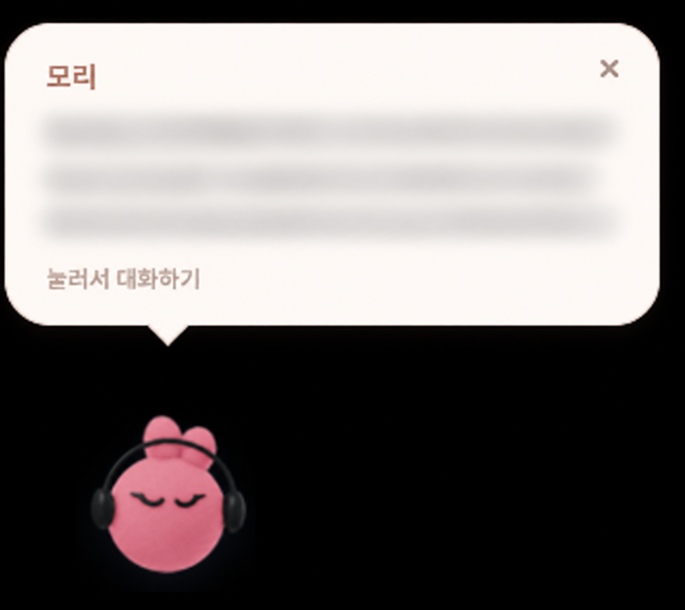
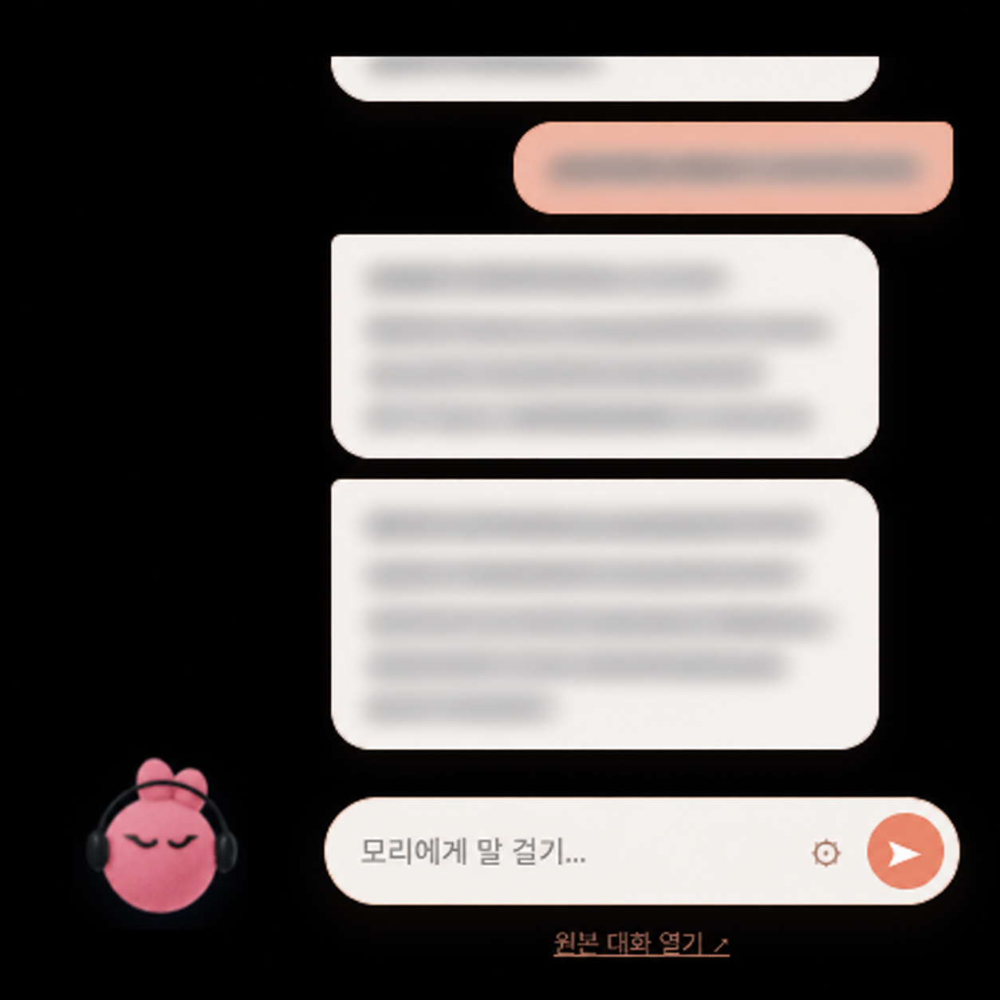

# Dot Pet

**기획·제작: [itsyennie](https://github.com/itsyennie)** · AI 개발 도구 활용 · [공식 저장소](https://github.com/itsyennie/dot-pet)

Windows 화면 구석에서 함께하는 작은 데스크톱 컴패니언입니다. 기본 캐릭터 이름은 **모리**입니다. 캐릭터를 클릭하면 옆에 투명한 말풍선과 입력창이 열리고, 본인의 ChatGPT dot과 대화할 수 있습니다.


**[Windows 다운로드 · 0.6.1](https://github.com/itsyennie/dot-pet/releases/tag/v0.6.1)** · [문제 신고](https://github.com/itsyennie/dot-pet/issues)

## 화면 미리보기

### 1. 모리가 새 메시지를 보낼 때

캐릭터를 누르지 않은 상태에서 연결된 닷츠 웹 화면에 새 메시지가 도착하면 작은 알림 말풍선이 나타납니다. 말풍선을 누르면 대화를 이어갈 수 있습니다.



### 2. 모리를 클릭했을 때

캐릭터 옆에 배경 없는 말풍선 대화창과 입력창이 열립니다. 입력창의 설정 버튼으로 이름과 캐릭터 크기 등을 바꿀 수 있습니다.



위 이미지는 사용자가 제공한 화면을 바탕으로 대화 부분을 블러 형태로 가린 편집본입니다. 위쪽에 일부만 보이는 메시지를 포함해 대화 내용은 공개하지 않았습니다. 캐릭터는 사용자 설정 예시입니다.

## 설치하고 시작하기

1. 릴리스에서 **Dot-Pet-Setup-0.6.1.exe**를 내려받아 실행합니다. 설치 없이 시험하려면 **Dot-Pet-Portable-0.6.1.exe**를 선택합니다.
2. 모리 캐릭터를 클릭합니다. 기존 로그인 세션이 있으면 대화를 연결합니다.
3. 처음 사용하면 열린 원본 대화 창에서 **본인의 ChatGPT 계정**으로 로그인하고 dot 대화를 엽니다. 화면 위의 **연결 확인**을 누르거나 캐릭터를 다시 클릭합니다.
4. 말풍선에 입력하고 Enter 또는 보내기 버튼을 누릅니다. Shift+Enter는 줄바꿈입니다. 전송을 확인하면 ‘생각 중…’으로 바뀌고 답변이 표시됩니다.

필요 조건: Windows 10/11 64비트, 인터넷 연결, ChatGPT에서 dots를 사용할 수 있는 본인 계정. 계정별 서비스 이용 조건과 제한이 적용됩니다. 이 앱은 OpenAI API 키를 사용하지 않으며 별도 API 사용료를 발생시키는 코드는 없습니다.

설치된 앱 목록과 시작 메뉴에는 **dot-pet**으로 표시됩니다. 기존 버전 위에 설치하면 캐릭터 설정과 로그인 세션을 이어서 사용합니다. 설치 파일은 코드 서명되지 않았으므로 Windows에서 게시자 확인 알림이 표시되거나 조직 정책에 따라 실행이 제한될 수 있습니다.

## 조작

| 동작 | 방법 |
|---|---|
| 대화 열기·닫기 | 캐릭터 클릭, 대화창에서 Esc |
| 위치 이동 | 캐릭터를 잡아 드래그. 모서리 가까이에서 자동 정렬 |
| 설정 열기 | 캐릭터 우클릭 또는 입력창의 ⚙ |
| 크기 변경 | 설정의 크기 슬라이더, 기본 크기의 70~170% |
| 이름·이미지 변경 | 설정에서 이름과 PNG/JPG/WebP 이미지 선택, 최대 3MB |
| 잠시 숨기기·종료 | Windows 알림 영역의 모리 트레이 메뉴 |
| 시작 시 실행 | 설정의 ‘Windows 시작 시 실행’을 직접 선택 |

닷츠 주소의 기본값은 https://chatgpt.com/dots/home 입니다. 캐릭터와 이름을 계정에서 자동으로 가져오지는 않습니다. 다른 프로그램 위에 표시되지만 Windows 보안 화면이나 일부 전체 화면 프로그램에서는 보이지 않을 수 있습니다.

## 새 메시지 말풍선 알림

앱이 켜져 있고 ChatGPT dot에 로그인되어 있으면, 대화창을 닫아둔 동안에도 연결된 웹 화면에 새로 도착한 메시지를 확인합니다. 캐릭터 위에 작은 말풍선이 나타나며 화면 위쪽에 공간이 없으면 아래에 표시됩니다.

- 입력 포커스를 뺏지 않고 약 15초 동안 표시합니다. 말풍선을 누르면 대화가 열리고 ×로 바로 닫을 수 있습니다.
- 캐릭터를 움직이거나 크기를 바꾸면 말풍선도 따라갑니다. 캐릭터를 숨기거나 대화창/원본 창을 보고 있을 때는 알리지 않습니다.
- 이전 대화, 내가 보낸 메시지, 이미 알린 메시지는 다시 알리지 않습니다. 여러 답변 말풍선은 모아서 보여줍니다.
- 약 3초 간격으로 확인하고 답변이 안정된 뒤 표시하므로 몇 초 지연될 수 있습니다. 앱 시작·페이지 재연결 직후에는 과거 대화를 먼저 불러옵니다.

알림은 **웹 화면에 실제로 새 메시지가 도착했을 때** 동작합니다. 앱이 먼저 메시지를 생성하거나 전송하지 않으며, 앱이 꺼져 있거나 로그인/연결이 끊긴 상태에서는 받을 수 없습니다.

## 연결과 수신 문제

- **원본 대화 열기**에서 로그인 상태와 원본 메시지를 확인하세요. 원본 창을 닫아도 백그라운드 대화 창은 유지됩니다.
- **전송 확인 중…**은 메시지가 원본 대화에 추가됐는지 확인하는 단계이고, **생각 중…**은 추가된 뒤 답변을 기다리는 단계입니다.
- 답변 확인 시간이 지나면 **답변 다시 확인**을 누릅니다. 이 버튼은 메시지를 재전송하지 않습니다.
- 창을 숨긴 상태에서도 실제 ‘보내기’ 버튼으로 전송합니다. 연결한 페이지 구조가 바뀌면 업데이트가 필요할 수 있습니다.
- 모리가 없으면 시작 메뉴의 dot-pet을 실행하거나 트레이에서 표시를 선택하세요.

## 개인정보와 연동 방식

OpenAI·ChatGPT의 공식 앱 또는 공식 dot 임베드가 아닙니다. 로그인한 ChatGPT 웹 화면의 입력창과 메시지를 읽고 조작하는 **실험적 연동**입니다. 웹 화면 변경이나 로그인 정책에 따라 동작이 중단될 수 있습니다.

각 사용자는 자신의 계정으로 로그인합니다. 배포본에는 개발자의 계정·대화·로그인 세션·개인 설정이 없습니다. 앱의 대화 내용은 ChatGPT로 전송되며 자체 중계 서버는 없습니다. 로그인 과정에서는 계정 제공자의 서비스가 열릴 수 있습니다. 세션과 설정은 Windows 사용자 프로필의 로컬 앱 데이터에 저장됩니다. 자세한 내용은 [SECURITY.md](SECURITY.md)를 확인하세요.

## 업데이트·제거

업데이트는 앱을 종료하고 새 설치 파일을 실행합니다. 자동 업데이트는 제공하지 않습니다. 기존 사용자는 제거하지 말고 설치 파일로 업데이트하세요.

설치 버전 제거: **Windows 설정 → 앱 → dot-pet → 제거**. 제거 시 모리 전용 설정과 로그인 세션도 삭제됩니다. 무설치 버전은 실행 파일을 삭제해도 사용자 프로필의 설정·세션은 남습니다. 같은 Windows 계정의 설치 버전과 무설치 버전은 앱 데이터를 공유하므로 동시에 실행하지 마세요.

## 제작자와 이용 조건

**기획·제작: itsyennie.** AI 개발 도구를 활용해 제작했습니다.

- 개인용·업무용으로 무료로 설치하고 사용할 수 있습니다. 본인 사용을 위한 소스 수정과 빌드도 허용합니다.
- 다른 사람에게 소개할 때는 [공식 다운로드 페이지](https://github.com/itsyennie/dot-pet/releases)를 공유해 주세요.
- 수정본 재배포, 앱 판매, 다른 제품에 포함해 배포하려는 경우 제작자에게 먼저 문의해 주세요. 제작자가 권리를 가진 부분의 해당 이용에는 사전 허락이 필요합니다.
- 제작자 표기와 이용 조건을 유지하고, 수정본을 제작자의 공식 버전으로 표시하지 마세요.
- 외부 라이브러리·캐릭터·상표에는 각 권리자의 조건이 적용됩니다. AI 생성 부분 전체에 독점적 저작권이 있다고 주장하지 않습니다.

자세한 범위와 예외는 [이용 조건](LICENSE.md) 및 [제3자 고지](THIRD_PARTY_NOTICES.md)를 확인하세요. 이용 허락 문의는 [GitHub 이슈](https://github.com/itsyennie/dot-pet/issues/new)로 남길 수 있습니다.

## 개발 및 빌드

Node.js 22.12 이상, npm, Windows 64비트를 사용합니다.

```powershell
npm ci
npm run check
npm test
npm start
npm run dist
```

결과는 dist/에 설치형 NSIS와 무설치 실행 파일로 생성됩니다. tests/는 로컬 가짜 대화 화면만 사용하며 실제 ChatGPT 계정에 로그인하거나 메시지를 보내지 않습니다. Electron·Chromium 등 포함 라이브러리의 고지는 [THIRD_PARTY_NOTICES.md](THIRD_PARTY_NOTICES.md)를 확인하세요.

[변경 내역](CHANGELOG.md) · [검증 기록](VALIDATION.md)
